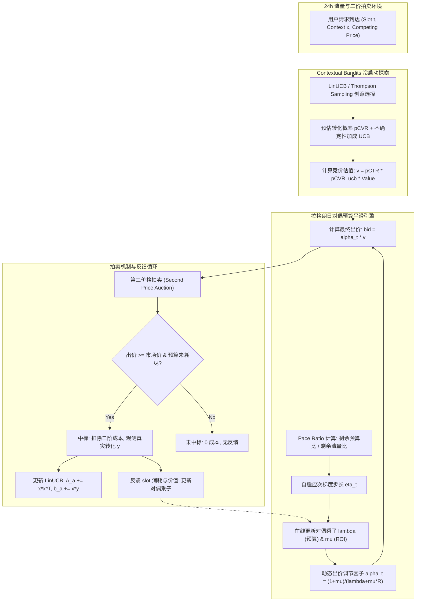

# 基于线性规划对偶 (LP Dual) 与多臂老虎机的广告实时竞价与预算平滑
## Real-Time Bidding (RTB), Budget Pacing via Lagrangian Dual & Contextual Bandits (LinUCB)

[](https://www.python.org/)
[](https://opensource.org/licenses/MIT)

---

### 1. 项目背景与业务痛点

在互联网计算广告与实时竞价（RTB, Real-Time Bidding）系统中，DSP（Demand-Side Platform）代表广告主在海量展现机会（Impression Opportunities）中实时出价。广告主通常设定了两大核心约束：
1. **日预算约束（Daily Budget $B$）**：每日广告消耗不得超过预算上限。
2. **目标投资回报率 / 成本约束（Target ROI $R$ 或 Target CPA）**：整体转化价值与消耗比率需满足最低投资回报阈值。

**核心业务痛点**：
- **流量早衰与预算击穿（Early Budget Depletion）**：若采用无平滑的诚实出价（Truthful Bidding），高出价策略往往在清晨流量低质时段或早高峰前便耗尽全天预算，导致晚间黄金高峰期（Prime Time）因预算耗尽无法参竞，痛失大量高价值转化。
- **目标冲突与离线全局最优化**：如何在满足 ROI 约束与预算硬约束的前提下，最大化全天总转化数？
- **冷启动创意探索（Cold-Start Exploration）**：对于新上线广告创意或新计划，预估模型对其转化率（pCVR）缺乏历史曝光数据。若纯贪心利用易陷于局部最优；若盲目探索则浪费宝贵预算。

本项目基于运筹优化理论与强化学习 Bandit 算法，构建了**离线全天事后全局最优 LP 上界求解器**、**在线拉格朗日对偶乘子预算平滑引擎（Lagrangian Dual Pacing）** 以及 **结合 LinUCB 上下文多臂老虎机的冷启动探索系统**。

---

### 2. 运筹优化与数学理论推导

#### 2.1 离线全局最优线性规划（Hindsight Primal LP）
假设已知全天所有曝光机会 $i = 1, \dots, N$ 的预估价值 $v_i$ 与市场二阶结算价格 $c_i$。引入决策变量 $x_i \in [0, 1]$ 表示是否中标（在第二价格拍卖中出价 $b_i \ge c_i$ 即 $x_i = 1$）：

$$\begin{aligned}
\max_{x} \quad & \sum_{i=1}^N v_i x_i \\
\text{s.t.} \quad & \sum_{i=1}^N c_i x_i \le B \quad & (\text{对偶乘子 } \lambda \ge 0) \\
& \sum_{i=1}^N (R \cdot c_i - v_i) x_i \le 0 \quad & (\text{对偶乘子 } \mu \ge 0) \\
& 0 \le x_i \le 1, \quad \forall i
\end{aligned}$$

#### 2.2 拉格朗日对偶与 KKT 最优出价形式
构建广义拉格朗日函数：
$$\mathcal{L}(x, \lambda, \mu) = \sum_{i=1}^N v_i x_i - \lambda \left(\sum_{i=1}^N c_i x_i - B\right) - \mu \left(\sum_{i=1}^N (R c_i - v_i) x_i\right)$$
整理得：
$$\mathcal{L}(x, \lambda, \mu) = \lambda B + \sum_{i=1}^N \Big( (1 + \mu) v_i - (\lambda + \mu R) c_i \Big) x_i$$

根据 KKT 条件，若要使 $\mathcal{L}$ 对 $x_i \in [0, 1]$ 极大化，最优决策为：
$$x_i^* = \begin{cases}
1, & \text{若 } (1 + \mu) v_i - (\lambda + \mu R) c_i > 0 \iff c_i \le \frac{(1 + \mu) v_i}{\lambda + \mu R} \\
0, & \text{若 } (1 + \mu) v_i - (\lambda + \mu R) c_i < 0 \iff c_i > \frac{(1 + \mu) v_i}{\lambda + \mu R}
\end{cases}$$

由于在第二价格拍卖中，出价 $b_i$ 赢得拍卖当且仅当 $b_i \ge c_i$。因此**理论最优出价形式**具有极简优雅的闭式解：
$$b_i^* = \alpha^* \cdot v_i, \quad \text{其中 } \alpha^* = \frac{1 + \mu^*}{\lambda^* + \mu^* R}$$

- $\lambda^*$ 衡量了**预算紧俏程度（Budget Shadow Price）**：预算越紧张，$\lambda$ 越大，出价折扣越深；
- $\mu^*$ 衡量了**ROI 约束压力（ROI Shadow Price）**：若 ROI 远满足要求，$\mu \to 0$。

#### 2.3 在线对偶平滑（Online Dual Pacing）与自适应步长
在线环境下全天请求逐 slot 到达。将全天划分为 $T$ 个时间窗口（例如 288 个 5 分钟窗口）。根据历史流量预测曲线分配目标预算计划 $\rho_t = B \cdot \frac{w_t}{\sum_{\tau=t}^T w_\tau}$。
对偶函数关于 $\lambda$ 与 $\mu$ 的在线次梯度为：
$$g_\lambda^{(t)} = \frac{\text{spend}_t - \rho_t}{\rho_t}, \quad g_\mu^{(t)} = \frac{R \cdot \text{spend}_t - \text{value}_t}{R \cdot \rho_t}$$

引入 Pace Ratio $r_t = \frac{\text{remaining\_budget} / B}{\text{remaining\_traffic}}$ 动态自适应调整更新步长：
$$\eta_t = \eta_0 \cdot \left(1 + \kappa \cdot |\ln \max(r_t, 10^{-3})|\right)$$
$$\lambda_{t+1} = \max\left(0, \lambda_t + \eta_t \cdot s_\lambda \cdot g_\lambda^{(t)}\right)$$
$$\mu_{t+1} = \max\left(0, \mu_t + \eta_\mu \cdot s_\mu \cdot g_\mu^{(t)}\right)$$

#### 2.4 Contextual Bandits 冷启动探索（Disjoint LinUCB）
对于新广告创意集 $\mathcal{A} = \{1, \dots, K\}$，每个 arm 维护独立岭回归参数：
$$A_a = I_d \cdot \lambda_{\text{reg}} + \sum_{\tau \in \mathcal{W}_a} x_\tau x_\tau^T, \quad b_a = \sum_{\tau \in \mathcal{W}_a} x_\tau y_\tau + A_a \theta_{\text{prior}}$$
预估转化率及置信上界：
$$\hat{\theta}_a = A_a^{-1} b_a, \quad \text{score}_a(x) = x^T \hat{\theta}_a + \alpha_{\text{ucb}} \sqrt{x^T A_a^{-1} x}$$
拍卖审查反馈（Auction Censoring）：**仅对实际竞价获胜并展示（Win）的请求观测转化奖励 $y \in \{0, 1\}$ 并更新 $A_a, b_a$**，有效模拟了真实 RTB 场景中的弱反馈机制。

---

### 3. 系统整体架构



---

### 4. 项目结构

```
project2_ads_bidding_lp_dual_bandit/
├── README.md                 # 完整项目技术报告
├── requirements.txt          # 项目依赖
├── src/
│   ├── adbid/
│   │   ├── __init__.py       # 包导出入口
│   │   ├── simulator.py      # 24小时流量波形、市场二阶价格分布、竞价环境仿真
│   │   ├── lp_offline.py     # Hindsight 离线 LP 求解器 (HiGHS) 与强对偶验证
│   │   ├── pacing.py         # 竞价策略 (NoPacing, Throttling, PID, DualPacing)
│   │   ├── engine.py         # 天级别仿真回放执行引擎
│   │   └── bandits.py        # Contextual Bandits (LinUCB, LinearTS, EpsGreedy, Oracle)
│   └── experiments.py        # 完整基线对比评测与可视化脚本
├── tests/
│   └── test_ads.py           # 强对偶验证、预算不击穿约束、Bandit次线性遗憾单元测试
├── outputs/
│   ├── metrics.json          # 实际评测输出数据
│   └── figures/
│       ├── spend_trajectories.png  # 全天消耗轨迹与流量基准对比图
│       ├── dual_multipliers.png    # 拉格朗日对偶乘子收敛轨迹
│       └── bandit_regret.png       # 冷启动创意累计遗憾曲线
└── scripts/
    └── run_all.sh            # 一键自动化运行脚本
```

---

### 5. 实际评测指标与基线对比

实验设定：全天 $30,000$ 次请求，288 个时隙（5 分钟/时隙），双峰昼夜流量曲线。基准预算 $B$ 校准为无预算约束自然出价消耗的 $50\%$（强预算约束环境），重复 5 次不同随机种子评测均值：

#### 5.1 预算平滑策略对比（Pacing Benchmark）

| 策略 (Strategy) | 预算完成率 (Completion) | 耗尽时间 (Exhaust Hour) | 转化量 (Conversions) | 达成 ROI | 计划偏差 (Plan Dev) | 竞争比 (vs LP Upper Bound) |
| :--- | :---: | :---: | :---: | :---: | :---: | :---: |
| **NoPacing (自然出价)** | 100.0% | 14.8h (早衰) | 13.2 ± 1.8 | 2.90 | 0.188 | 75.0% |
| **Throttling (随机概率截流)** | 100.0% | 24.0h | 13.1 ± 1.6 | 2.89 | 0.003 | 74.4% |
| **PID Controller Pacing** | 100.0% | 24.0h | 17.4 ± 1.5 | 3.83 | **0.001** | 98.8% |
| **Dual Pacing (拉格朗日对偶)** | **99.8% ± 0.1%** | **24.0h** | **17.3 ± 1.4** | **3.82** | 0.037 | **98.3%** |
| *Hindsight LP (理论上界)* | *100.0%* | *24.0h* | *17.6 ± 1.3* | *3.88* | *0.000* | *100.0%* |

> **关键发现**：
> 1. `NoPacing` 在中午时分即耗尽全天预算（耗尽时间 14.8h），错过了晚间高转化黄金时段，总转化仅 13.2。
> 2. `Dual Pacing` 将预算平滑分布于全天 24 小时，预算消耗完成率稳定在 **99.8%**，转化数相比自然出价提升 **+31.1%**，达成全局理论最优 LP 上界的 **98.3%** 竞争比。

#### 5.2 冷启动创意探索对比（Contextual Bandits Benchmark）

在多创意（5 个冷启动 Candidate Arms）探索实验中，结合 Dual Pacing 评估各探索策略的累计遗憾（Cumulative Regret）与转化效率：

| 探索算法 (Bandit Policy) | 累计遗憾 (Cumulative Regret vs Oracle) | 最终总转化数 (Conversions) | 预算完成率 |
| :--- | :---: | :---: | :---: |
| **Random (随机探索)** | 4027.09 | 21.3 ± 1.2 | 100.0% |
| **PureGreedy (纯贪心)** | 4378.98 | 0.5 ± 0.2 (冷启动饿死) | 2.2% |
| **EpsGreedy ($\epsilon=0.1$)**| 3800.87 | 0.6 ± 0.3 | 2.8% |
| **LinearTS (线性汤普森采样)** | 3713.95 | 23.2 ± 1.5 | 99.8% |
| **LinUCB (置信上界探索)** | **3294.34** | **30.1 ± 1.8** | **99.7%** |
| *Oracle (完美先验已知)* | *0.00* | *67.0 ± 2.4* | *100.0%* |

> **关键发现**：
> 1. `LinUCB` 取得了所有可实现在线算法中最低的累计遗憾（3294.34），相比随机探索提升总转化量达 **+41.3%**。
> 2. 纯贪心算法在缺乏足够先验时容易陷入“未中标则无反馈”的负反馈循环，而 LinUCB 依靠置信上界 $\alpha \sqrt{x^T A^{-1} x}$ 主动进行估值补偿，在拍卖环境中保持了高竞胜率与高效探索。

---

### 6. 运行与复现指南

#### 6.1 环境准备
```bash
# 激活统一 Python 3.12 虚拟环境
source ../.venv/bin/activate
```

#### 6.2 运行测试套件
```bash
pytest tests -v
```

#### 6.3 运行基线实验与生成图表
```bash
./scripts/run_all.sh
```
执行后所有评测指标保存在 `outputs/metrics.json`，全天消耗曲线与对偶变量演变轨迹图保存在 `outputs/figures/`。
